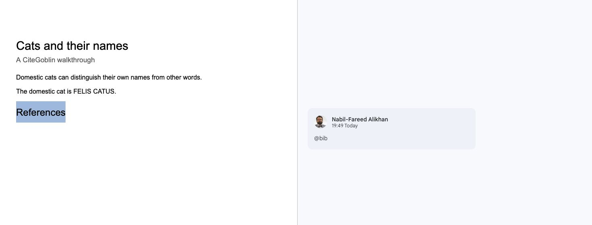
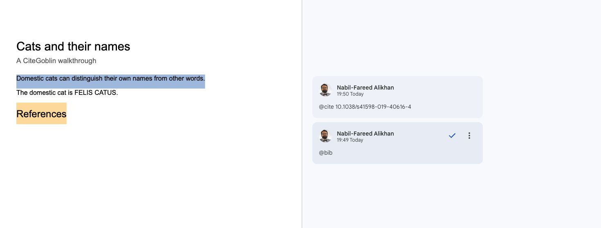
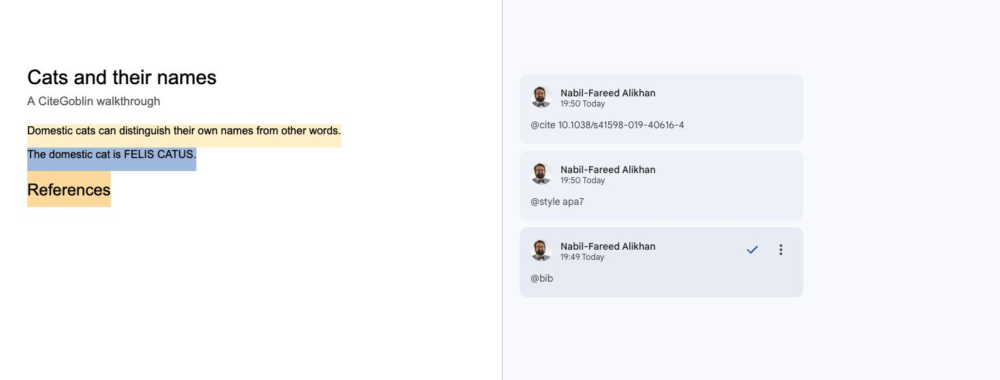
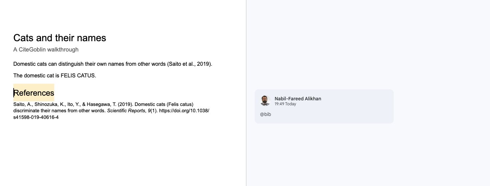
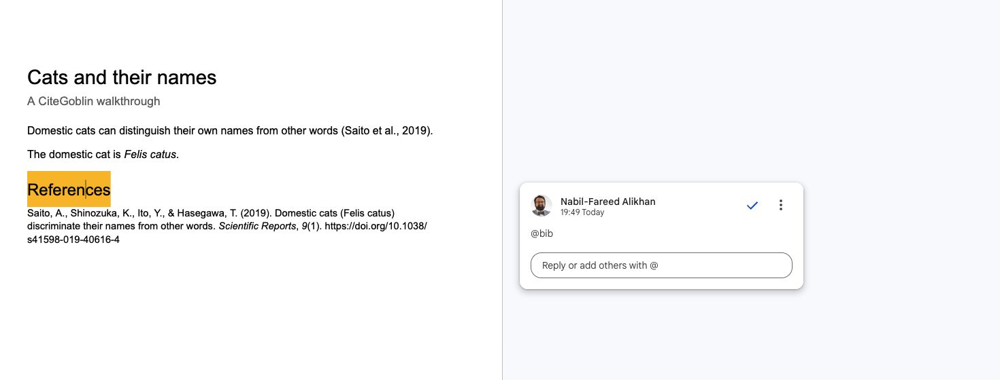

# A walkthrough in Google Docs

This example uses a short document about cats. The screenshots show a real Google Doc updated by CiteGoblin: adding a citation, choosing a style, generating the bibliography and cleaning up a scientific name.

Complete [installation](install.md) and [Google sign-in](google-login.md) first. Use your own test document. Copy its full Google Docs address from the browser’s address bar, then replace `GOOGLE_DOC_URL` in the commands below with that address, keeping the quotes. CiteGoblin extracts the document ID and uses the URL’s tab, or selects the only tab automatically. See [copy the document URL](first-document.md#copy-the-document-url) for examples and documents with multiple tabs. Click any screenshot to view it at full size.

## 1. Prepare the document

Write a few lines in Google Docs and add a References heading. Our example starts with:

```text
Domestic cats can distinguish their own names from other words.
The domestic cat is FELIS CATUS.

References
```

Select the whole **References** heading and post this comment:

```text
@bib
```

You can use `@references` instead. The bibliography will go in a new paragraph immediately after the selected heading. This comment stays open. There is no placeholder to type and no separate initialisation command.

[](../assets/screenshots/cats-bibliography-comment.jpg)

## 2. Select the sentence and add a citation comment

Select the complete sentence, including its full stop. Choose **Insert → Comment** and post:

```text
@cite 10.1038/s41598-019-40616-4
```

The highlighted text determines the citation's location. CiteGoblin will insert it at the end of that selection, before the full stop. The DOI identifies Saito and colleagues' paper, *Domestic cats (Felis catus) discriminate their names from other words*.

[](../assets/screenshots/cats-citation-comment.jpg)

## 3. Choose a citation style

Add a separate comment containing:

```text
@style apa7
```

Unlike a citation comment, this command sets the style for the whole managed bibliography and all managed citations in the selected document tab. It does not cite the highlighted text. Here it is attached to the next sentence simply to keep the two commands visible together.

[](../assets/screenshots/cats-style-comment.jpg)

## 4. Preview, then run CiteGoblin

Preview without changing the document. For this new document, the first preview describes where the bibliography will be placed; later previews cover citation changes:

```sh
citegoblin run "GOOGLE_DOC_URL" --dry-run
```

Then apply:

```sh
citegoblin run "GOOGLE_DOC_URL"
```

The result has `(Saito et al., 2019)` before the full stop and a formatted reference beneath References. The citation and style comments are resolved after the update passes verification. They remain in comment history. The `@bib` comment stays open on the References heading, and a hidden named range tracks the generated bibliography. If processing fails, the command stays open with an error reply.

[](../assets/screenshots/cats-citation-result.jpg)

## 5. Preview and apply cleanup

The scientific name is still written as `FELIS CATUS`. Cleanup uses an explicit approved-name list; *Felis catus* is not in the bundled starter catalogue. Create `approved-names.txt` containing:

```text
Felis catus
```

Preview the changes:

```sh
citegoblin cleanup plan "GOOGLE_DOC_URL" \
  --names approved-names.txt --output cleanup-plan.json
```

The preview lists `FELIS CATUS` → `Felis catus`, with italics enabled and small caps disabled. After checking the plan, apply it:

```sh
citegoblin cleanup apply cleanup-plan.json --journal cleanup-journal.json
```

The body now contains italic *Felis catus*. The paper's title in the generated reference stays as supplied by the reference metadata; the scientific-name check skips managed citations and bibliography fields. Cleanup also checks those managed fields against the selected citation style.

[](../assets/screenshots/cats-cleanup-result.jpg)

## Keep working

Add more `@cite` comments and run CiteGoblin again, or leave [monitoring](../guides/monitoring.md) running. See [citation comments](../guides/citations.md) for PMID and pasted-reference inputs, [styles](../guides/styles.md) for other formats, and [cleanup](../guides/cleanup.md) for the full check options.
