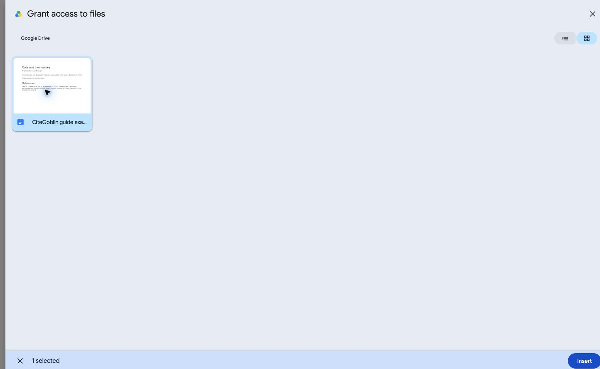

# Sign in with Google

An API key cannot authorise edits to a private Google Doc. CiteGoblin uses desktop OAuth: Google opens in your browser, you choose your account and approve access, and CiteGoblin saves the authorisation for later runs. Google passwords never pass through CiteGoblin.

**Beta testers:** ask the maintainer to add your Google-account email to the test list, then obtain the desktop OAuth client JSON privately or use the supplied beta package. The registered application is External, in Testing mode. You do not need your own Google Cloud project. No user tokens are included in the package or public repository.

**Maintainers or self-hosted installations:** application registration is a one-time step:

1. Create a Google Cloud project and enable **Google Docs API**, **Google Drive API** and **Google Picker API**.
2. Configure the OAuth consent screen for CiteGoblin. For external testing, choose External → Testing and add authorised test users. Declare only `https://www.googleapis.com/auth/drive.file` under Data access.
3. Create an OAuth client with application type **Desktop app**, then download its JSON configuration. This is an OAuth client configuration, not an API key or a service-account key.
4. Run:

```sh
citegoblin login --client-secrets /path/to/downloaded-client.json
```

The browser opens Google’s account chooser, per-file consent page and document picker. Use the account that has editing and commenting access to the document, select the Google Docs you want CiteGoblin to use, then click **Insert**. This grants access only to selected files and files CiteGoblin creates. The callback returns to a temporary local listener on `127.0.0.1`; no public server, browser automation or copied verification code is required.

To connect another document, copy its full URL and run:

```sh
citegoblin connect "GOOGLE_DOC_URL"
```

This opens the same Google flow with the requested document shown in the picker. Select it and click **Insert**. CiteGoblin verifies that it can read the requested document before reporting success. Subsequent `run`, `cleanup` and `export` commands use its URL normally. A pasted URL alone does not authorise an unselected existing file; denied access produces a `connect` instruction.

[](../assets/screenshots/google-select-document.jpg)

During the upgrade from the broad-access prototype, CiteGoblin revokes its saved earlier broad grant before signing in again. Re-select the documents you want it to access. Saved tokens with broader scopes are not reused, and new consent explicitly excludes earlier granted scopes.

Once a desktop client is configured, the first `run`, `init` or `apply` automatically opens sign-in in an interactive terminal if no usable authorisation exists. Later runs reuse it and refresh expired access tokens automatically. Revoked permissions trigger sign-in again; temporary network failures produce an error without needlessly starting a new login. Non-interactive runs never start a browser: run `login` once in a terminal first.

The OAuth client is configured once per installation. For a distributed release, the maintainer can supply a registered desktop client configuration so each user only needs to sign in. A public client configuration is not a user's token; never distribute access tokens, refresh tokens or service-account keys. Google consent/publishing and organisation policies still apply. See [Google's desktop OAuth guide](https://developers.google.com/identity/protocols/oauth2/native-app).

## Saved authorisation

Tokens are stored in the operating system's keychain by default: macOS Keychain, Windows Credential Manager or a supported Linux secret store. Plaintext fallback is never automatic. If no supported keychain is available, explicitly choose private file storage:

```sh
citegoblin login --client-secrets /path/to/downloaded-client.json --token-file /private/path/token.json
```

That choice is remembered locally. On POSIX systems the token file is written with owner-only permissions. Do not share or commit it. `CITEGOBLIN_TOKEN_FILE` can override the path; `CITEGOBLIN_CLIENT_CONFIG` can point to a preconfigured desktop client JSON.

```sh
citegoblin auth-status
citegoblin logout
```

`auth-status` never displays tokens. `logout` removes the local token; it does not revoke Google's grant or stop an already-running process. Access can also be revoked in your Google Account's connected-app settings.

The only requested scope is `https://www.googleapis.com/auth/drive.file`. It covers Docs reads/edits, comment replies and resolution, and the temporary exports needed for comment-anchor recovery. The broad `drive` and `documents` scopes are not requested. CiteGoblin resolves successful citation and style threads; bibliography-location comments stay open. It never deletes comments or replies. Failed commands remain open with one maintained error reply. See [Google’s per-file permission guidance](https://developers.google.com/workspace/drive/api/guides/api-specific-auth) and [desktop Picker integration](https://developers.google.com/workspace/drive/picker/guides/desktop-mobile-picker).

For servers, existing Application Default Credentials remain available explicitly: set `CITEGOBLIN_AUTH=adc`, or set `GOOGLE_APPLICATION_CREDENTIALS` to an approved credentials file. These modes do not launch browser sign-in. A service account must have document editing and commenting access.

## External beta testing

The maintainer’s app is configured as **External → Testing**, with only the non-sensitive `drive.file` scope declared. Testers must be on its Google-account allowlist before signing in. The test list can be expanded when addresses are known; no app rebuild is needed. See the [beta setup guide](beta-testing.md).

Google limits Testing mode to 100 allowlisted users. Testing-mode refresh tokens normally expire after seven days for this scope, so testers may need to sign in again. Workspace administrators can also restrict access. See Google’s [app-state overview](https://developers.google.com/identity/protocols/oauth2/production-readiness/overview) and [refresh-token rules](https://developers.google.com/identity/protocols/oauth2#expiration).

This is a beta configuration, not a verified public launch. Per-file access avoids the former restricted full-Drive scope. A public launch still needs the relevant branding, website/privacy information and publishing requirements reviewed. See [Google’s scope classifications](https://developers.google.com/workspace/drive/api/guides/api-specific-auth).
