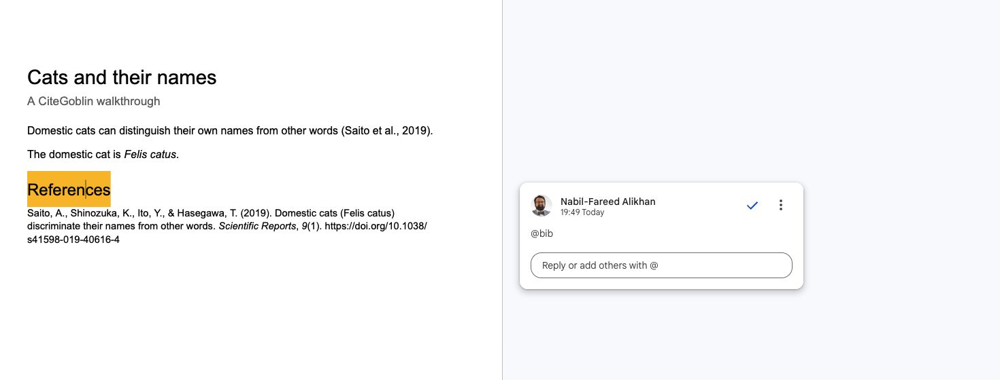

# Cleanup in References

`cleanup` works only on CiteGoblin’s generated **References** list. It cleans the stored reference titles before rebuilding the bibliography in the selected citation style. The imported metadata remains intact; corrections are stored separately. Body text, body formatting and in-text citations stay unchanged.

Preview and apply:

```sh
citegoblin cleanup plan "GOOGLE_DOC_URL" --output cleanup-plan.json
citegoblin cleanup apply cleanup-plan.json --journal cleanup-journal.json
```

The preview identifies its scope as **References only** and lists before/after reference-field corrections, scientific-name formatting changes and warnings. For example, a reference title containing `FELIS CATUS` becomes *Felis catus*: genus initial capital, species epithet lowercase, both words italic, small caps disabled. An already correctly cased but non-italic name also receives italics.

## Checks

The default `--check all` cleans reference titles, applies scientific-name rules and rebuilds References. `--check names` limits metadata corrections to scientific names; `--check metadata` performs title cleanup and name formatting; `--check bibliography` regenerates the list from the current metadata without adding new corrections.

## Imported title metadata

Cleanup corrects all-capitals titles to sentence case, decodes HTML entities, removes unsupported imported markup and collapses whitespace. Supported emphasis, superscripts and subscripts are retained. For example:

> GENOMIC SURVEILLANCE OF ESCHERICHIA COLI IN THE UK

becomes:

> Genomic surveillance of *Escherichia coli* in the UK

A local list protects common acronyms such as DNA, RNA, WGS and UK. Mixed-case titles are not automatically recased. An all-capitals import cannot tell us which other words are proper nouns or gene symbols: these conversions carry a review warning. Protect additional terms with their intended spelling:

```sh
citegoblin cleanup plan "GOOGLE_DOC_URL" \
  --preserve London --preserve blaNDM --output cleanup-plan.json
```

Inspect the preview before applying it. Cleanup does not infer missing authors, dates or journal names, and does not rewrite author names. The selected CSL style still controls bibliography presentation, including title case where required by that style.

Only corrected fields are saved alongside the original CSL metadata, keeping storage compact. Formatting, refreshes and BibTeX/RIS/EndNote exports use the corrected fields. To discard corrections and regenerate References from the imported metadata:

```sh
citegoblin cleanup plan "GOOGLE_DOC_URL" --restore --output restore-plan.json
citegoblin cleanup apply restore-plan.json --journal restore-journal.json
```

Restoration also disables scientific-name formatting rules. It leaves body text and in-text citations unchanged.

The document must already have a managed References list. Select the complete References heading, add an `@bib` or `@references` comment and run CiteGoblin first. Cleanup uses that hidden bibliography range; it does not infer a region from an ordinary heading.

Cleanup settings are saved with the document. Later citation updates, bibliography refreshes and explicit style changes apply those rules to the generated reference text again, so the scientific-name italics survive regeneration. Imported source metadata is retained as supplied; corrected title fields are stored separately and used when References are generated.

## Approved scientific names

The bundled catalogue contains 21 approved binomials, including *Felis catus*, checked against NCBI Taxonomy on 23 November 2026. Names retain their identity; cleanup does not update taxonomy. Extend the list with a text file containing one full binomial per line:

```sh
citegoblin cleanup plan "GOOGLE_DOC_URL" \
  --names approved-names.txt --output cleanup-plan.json
```

Add `--abbreviations` to format a name such as *E. coli* only when an earlier full-name mention in the same reference supplies unique genus context. Abbreviations are not expanded. Names retain their wording and strain codes; unrecognised names are not guessed. The name catalogue is local; scanning makes no taxonomy API requests.

## Before and after in Google Docs

Before cleanup, *Felis catus* appears in regular type within the reference title:

[](../assets/screenshots/cats-citation-result.jpg)

After cleanup, the name is italicised **inside References**. The body remains exactly as written:

[](../assets/screenshots/cats-cleanup-result.jpg)

The [walkthrough](../getting-started/cats-walkthrough.md#5-preview-and-apply-cleanup) includes the comment commands and cleanup steps.

## Verification

Every plan is guarded by the document revision. Before writing, cleanup checks that its text and formatting requests are confined to the managed bibliography. Readback verifies reference text and styles, source mappings, stored cleanup rules, and unchanged body text and formatting. References containing pending suggestions must be reviewed first.

An interrupted or uncertain write is retained for inspection and is never replayed automatically.
