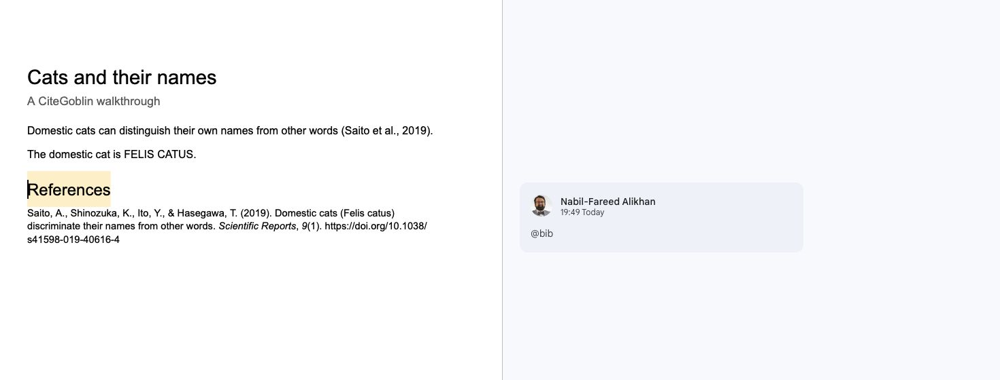

# Cleanup in References

Cleanup corrects imported reference titles and rebuilds the References list. It leaves body text and in-text citations unchanged.

To set up References, select the full heading, add an `@bib` or `@references` comment, and run CiteGoblin. Then preview the changes and apply the plan.

```sh
citegoblin cleanup plan "GOOGLE_DOC_URL" --output cleanup-plan.json
citegoblin cleanup apply cleanup-plan.json --journal cleanup-journal.json
```

The preview shows proposed title corrections, formatting changes and any warnings.

## Checks

The default `--check all` cleans reference titles, formats scientific names and rebuilds References. Use `--check names` for scientific name corrections only, `--check metadata` for title and name corrections, or `--check bibliography` to rebuild from the current metadata.

## Imported title metadata

Cleanup corrects all-capitals titles to sentence case, decodes HTML entities, removes unsupported imported markup and collapses whitespace. Supported emphasis, superscripts and subscripts are retained. For example:

> GENOMIC SURVEILLANCE OF ESCHERICHIA COLI IN THE UK

becomes:

> Genomic surveillance of *Escherichia coli* in the UK

A local list protects common acronyms such as DNA, RNA, WGS and UK. Mixed-case titles are not automatically recased. An all-capitals import cannot tell us which other words are proper nouns or gene symbols: these conversions carry a review warning. Protect additional terms with their intended spelling:

```sh
citegoblin cleanup plan "GOOGLE_DOC_URL" \
  --preserve London --preserve blaNDM --output cleanup-plan.json
```

Inspect the preview before applying it. Cleanup does not infer missing authors, dates or journal names, and does not rewrite author names. The selected CSL style still controls bibliography presentation, including title case where required by that style.

Only corrected fields are saved alongside the original CSL metadata, keeping storage compact. Formatting, refreshes and BibTeX/RIS/EndNote exports use the corrected fields. To discard corrections and regenerate References from the imported metadata:

```sh
citegoblin cleanup plan "GOOGLE_DOC_URL" --restore --output restore-plan.json
citegoblin cleanup apply restore-plan.json --journal restore-journal.json
```

Restoration also disables scientific-name formatting rules. It leaves body text and in-text citations unchanged.

## Scientific names

CiteGoblin uses a built-in list to correct the capitalisation and italics of scientific names in reference titles. To add names, pass a text file with one full scientific name per line.

```sh
citegoblin cleanup plan "GOOGLE_DOC_URL" \
  --names approved-names.txt --output cleanup-plan.json
```

Use `--abbreviations` to format abbreviated names such as *E. coli* when an earlier full name in the same reference identifies the genus.

## Before and after in Google Docs

Before cleanup, *Felis catus* appears in regular type within the reference title:

[](../assets/screenshots/cats-citation-result.jpg)

After cleanup, the name is italicised **inside References**. The body remains exactly as written:

[](../assets/screenshots/cats-cleanup-result.jpg)

The [walkthrough](../getting-started/cats-walkthrough.md#5-preview-and-apply-cleanup) includes the comment commands and cleanup steps.

## Verification

Every plan is guarded by the document revision. Before writing, cleanup checks that its text and formatting requests are confined to the managed bibliography. Readback verifies reference text and styles, source mappings, stored cleanup rules, and unchanged body text and formatting. References containing pending suggestions must be reviewed first.

An interrupted or uncertain write is retained for inspection and is never replayed automatically.
